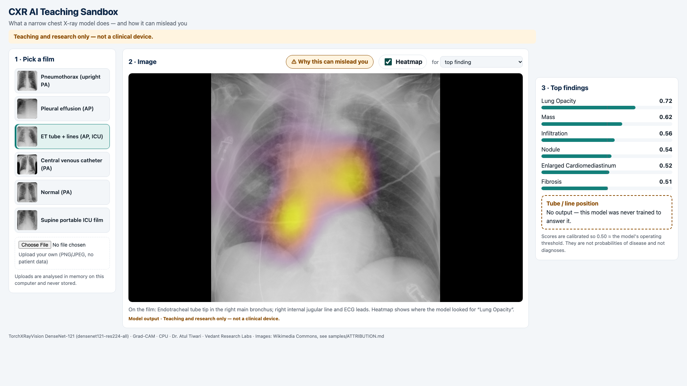

# CXR AI Teaching Sandbox

A small local web app that shows **what a narrow chest X-ray model does, and how it can mislead you**. Pick (or upload) a film → see the model's top findings → toggle a Grad-CAM heatmap → read *Why this can mislead you*.

> **Teaching and research only — not a clinical device.** Do not upload patient images.

Built for the lecture *AI in Imaging and Diagnostic Applications*, AI in Critical Care Workshop, CRITICARE 2027 (ISCCM, 4–7 Feb 2027).



## Run it (CPU only)

```bash
python -m venv .venv && source .venv/bin/activate
pip install -r requirements.txt
python app.py            # open http://127.0.0.1:7860
```

The first run downloads the TorchXRayVision weights (~30 MB). Each film takes under a second on a laptop CPU. Set `HOST`/`PORT` to change the address.

## What's inside

- **Model:** [TorchXRayVision](https://github.com/mlmed/torchxrayvision) DenseNet-121, weights `densenet121-res224-all` (trained on NIH ChestX-ray14, CheXpert, MIMIC-CXR, PadChest, RSNA, Google, OpenI and Kaggle data). 18 labels: atelectasis, consolidation, infiltration, pneumothorax, edema, emphysema, fibrosis, effusion, pneumonia, pleural thickening, cardiomegaly, nodule, mass, hernia, lung lesion, fracture, lung opacity, enlarged cardiomediastinum. **No tube or line position label.**
- **Scores** are the library's calibrated outputs: 0.50 sits at each label's operating threshold. They are not probabilities of disease.
- **Heatmap:** Grad-CAM on the last DenseNet block for the chosen label (default: top finding).
- **Preprocessing:** greyscale → square centre crop (as in training) → 224×224.
- **Backend:** FastAPI (`app.py`, `sandbox/model.py`). **Front end:** plain HTML/CSS/JS in `static/`. Uploads are processed in memory and never written to disk.
- **Images:** six openly licensed teaching films from Wikimedia Commons — pneumothorax, pleural effusion, ET tube + lines (AP ICU), central venous catheter, normal, supine portable ICU film. Sources and licences: [`samples/ATTRIBUTION.md`](samples/ATTRIBUTION.md).

## What to show an ICU audience

| Film | What the model does (as run here) |
|---|---|
| Pneumothorax (upright PA) | Top finding **Mass 0.80**; pneumothorax **0.50**, right at threshold. The pneumothorax heatmap sits over the trachea, not the pleural edge. |
| ET tube in right main bronchus | Top finding **Lung Opacity 0.72**. Heatmap around the carina/right hilum, near the tube tip and lines. **No output about tube position** — the clinically urgent finding. |
| Normal PA | Pleural thickening 0.51, fibrosis 0.50, pneumothorax 0.40 — near-threshold scores on a normal film. |
| Supine ICU pneumothorax | Lung opacity 0.89, effusion 0.61; pneumothorax 0.51 — a supine film is out of distribution. |

## Lecture clips

`video/record_demo.py` records the v1a demo with Playwright (1920×1080, visible cursor); `video/burn_captions.py` burns caption bars into a silent H.264 clip; `video/finish_v1b.py` captions a QuickTime recording of a chatbot without editing its answer.

## Tests

```bash
pip install -r requirements-dev.txt
pytest --cov=sandbox --cov=app
```

## Hugging Face Space (optional, not deployed)

The app runs as a Docker Space: create a Space with SDK "Docker", push this repo, and set `HOST=0.0.0.0`, `PORT=7860`. Keep the disclaimer visible.

## Limitations

See [`NOTES.md`](NOTES.md). In short: a research model, not validated on Indian ICU films, not able to answer tube/line questions, and its heatmaps are explanations of the model, not of the patient.

## Licence and credit

Code: MIT ([LICENSE](LICENSE)). Text and figures: CC BY 4.0. **Bundled images keep their own licences** (CC0, public domain, CC BY-SA 3.0/4.0 — see `samples/ATTRIBUTION.md`). TorchXRayVision is Apache-2.0.

Credit: **Dr. Atul Tiwari · Vedant Research Labs**
